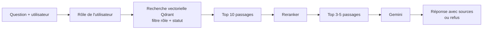

# Secure Enterprise Knowledge Assistant

Assistant de recherche documentaire pour entreprise, avec **contrôle d'accès par rôle**. Les employés de NovaTech Solutions (entreprise fictive) posent des questions en langage naturel sur les documents internes (RH, finance, IT, politiques) et ne reçoivent que les informations auxquelles leur rôle donne accès.

Projet de fin de cours AI Engineering, TEK-UP University (Data Science & AI Engineering), sujet n°5 : *Secure Enterprise Knowledge Assistant*.

## Présentation

Le projet combine une recherche vectorielle filtrée par permissions, un reranker cross-encodeur pré-entraîné puis affiné sur des exemples de pertinence, une gestion des versions de documents, un modèle de génération (Gemini) qui rédige la réponse à partir des passages autorisés, et un serveur MCP qui expose la recherche et la consultation des permissions. Toutes les données de contrôle (utilisateurs, cas d'accès, versions V2, questions sans réponse) sont synthétiques et signalées comme telles.

Le filtrage des droits est appliqué **dans la requête vectorielle, avant le classement** : un passage interdit n'est jamais récupéré puis masqué, il reste invisible. Seules les versions au statut `en_vigueur` sont retournées.

## Fonctionnement



Les étapes Reranker (module prêt, non branché) et Gemini (à faire) sont décrites dans « État d'avancement ».

## Structure du projet

```
Secure-Enterprise-Knowledge-Assistant/
├── synthetic/                 données synthétiques saisies à la main (versionnées)
│   ├── users.csv              6 utilisateurs fictifs, un par rôle au minimum
│   ├── access_tests.csv       38 cas d'accès (18 interdits, 20 accessibles)
│   ├── unanswerable.csv       10 questions hors corpus
│   ├── version_changes.csv    3 règles modifiées en V2
│   └── version_tests.csv      24 questions dont la réponse change entre V1 et V2
├── data/                      généré par les scripts, ne pas y déposer de fichiers à la main
│   ├── raw/                   dataset brut (hr_dataset_full.csv)
│   ├── processed/             plan des documents, split, metadata.csv, passages.jsonl
│   ├── corpus/                documents Markdown : *_V1.md (archivés pour 3 d'entre eux) et *_V2.md
│   ├── qdrant/                base vectorielle locale (régénérable, ignorée par Git)
│   └── eval/                  résultats d'évaluation (JSON et CSV)
├── models/                    reranker affiné (régénérable, ignoré par Git)
├── scripts/
│   ├── 1-download_hr.py       téléchargement et vérification du dataset
│   ├── 2-check_mapping.py     affichage des réponses et de leurs questions
│   ├── 3-prepare.py           regroupement en documents, découpage train/test
│   ├── 4-generate_corpus.py   corpus V1, métadonnées, passages
│   ├── 4b-generate_v2.py      version V2 des documents modifiés, archivage des V1
│   ├── 5-index.py             indexation Qdrant et recherche filtrée
│   ├── 6-eval_baseline.py     recherche par rôle, compteur de fuites, contrôle sans filtre
│   ├── 7-finetune_reranker.py entraînement et comparaison du reranker
│   ├── rerank.py              fonction de reranking à brancher dans la recherche finale
│   ├── demo_version.py        démonstration de la gestion des versions
│   └── check_synthetic.py     vérification des cas d'accès et des questions sans réponse
├── requirements.txt
├── .gitignore
├── .env.example
└── README.md
```

## Installation

Prérequis : Python 3.10 ou plus. Les commandes sont pour Windows PowerShell.

```powershell
python -m venv .venv
.venv\Scripts\Activate.ps1
pip install -r requirements.txt
```

Pour la génération avec Gemini (étape à venir), copier `.env.example` vers `.env` et renseigner la clé :

```
GEMINI_API_KEY=votre_cle
```

Le fichier `.env` ne doit jamais être versionné.

## Utilisation

Depuis le dossier `scripts/`, les étapes se lancent dans l'ordre suivant. Chaque étape lit les fichiers produits par la précédente.

```powershell
cd scripts
python 1-download_hr.py
python 3-prepare.py
python 4-generate_corpus.py
python 4b-generate_v2.py
python 5-index.py
python 6-eval_baseline.py --split test --role Administrator
python 6-eval_baseline.py --split test --role Employee --no-filter
python 7-finetune_reranker.py --epochs 2 --negs 3 --max-length 256 --name minilm_ft
python demo_version.py --role Employee
python check_synthetic.py --k 5
```

Règle : si `3-prepare.py` ou `4-generate_corpus.py` est relancé, relancer aussi `4b-generate_v2.py` puis `5-index.py`. `4-generate_corpus.py` remet toutes les versions en vigueur, et `4b` rétablit l'archivage des V1 modifiées.

Pour tester la recherche avec contrôle d'accès après l'indexation :

```powershell
python 5-index.py --test "How are PIP goals defined?" --role Employee
python 5-index.py --test "How are PIP goals defined?" --role "HR Manager"
```

Le premier appel ne doit renvoyer aucun passage de HR-08 (réservé aux RH). Le second doit faire remonter le passage sur les plans d'amélioration de la performance. Relancer `5-index.py` sans modification affiche « 0 à (re)indexer » : seuls les passages nouveaux ou modifiés sont réindexés, grâce à une empreinte de leur texte, de leur statut et de leur version.

## Description des fichiers

### `scripts/1-download_hr.py`

Télécharge le dataset `adarsh-08/hr-policy-dataset`, garde les colonnes `instruction` et `response`, puis vérifie la structure : 512 lignes, 512 questions uniques, 64 réponses uniques, 8 questions par réponse, aucune question dupliquée. Si une condition échoue, le script s'arrête. Il exporte ensuite le CSV et affiche une empreinte SHA256 à citer dans le rapport.

Entrée : Hugging Face. Sortie : `data/raw/hr_dataset_full.csv`.

### `scripts/2-check_mapping.py`

Attribue les identifiants R01 à R64 aux réponses, dans l'ordre d'apparition, et affiche chaque réponse avec ses 8 questions. Il n'écrit aucun fichier. Il sert de référence pour savoir à quoi correspond un identifiant comme R39 ou R64.

Entrée : `data/raw/hr_dataset_full.csv`. Sortie : affichage terminal.

### `scripts/3-prepare.py`

Regroupe les 64 réponses en 17 documents (titre, département, confidentialité, rôles autorisés) et découpe les données en train et test par réponse, avec la graine 42 et environ 30 % de test par document. Vérifie que chaque réponse appartient à un seul document.

Sorties dans `data/processed/` : `answers_by_document.csv`, `document_plan.csv`, `questions_split.csv` (512 questions, identifiants Q001 à Q512).

### `scripts/4-generate_corpus.py`

Écrit un fichier Markdown par document (17 fichiers `_V1.md`), avec un en-tête de métadonnées puis une section par réponse, le texte étant recopié sans modification. Produit `metadata.csv` (une ligne par document) et `passages.jsonl` (64 passages). Un passage a un identifiant de la forme `HR-04-V1-S03`.

### `scripts/4b-generate_v2.py`

Lit `synthetic/version_changes.csv` et crée la version V2 de trois documents : HR-04, FIN-03 et HR-12. Seules les réponses listées changent de texte ; les autres sections sont reprises à l'identique. Les 20 passages V1 de ces documents passent au statut `archive` ; les 20 passages V2 sont ajoutés au statut `en_vigueur`. Met à jour `metadata.csv` (version V2) et écrit `_V2.md`. Données synthétiques.

### `scripts/5-index.py`

Calcule le vecteur de chaque passage avec `BAAI/bge-small-en-v1.5` (titre du document, titre de section, texte) et les stocke dans Qdrant avec leurs métadonnées. L'empreinte de chaque passage inclut son texte, son statut et sa version : un changement de l'un de ces trois éléments déclenche la réindexation de ce seul passage. Contient la fonction de recherche filtrée par statut et par rôle.

### `scripts/6-eval_baseline.py`

Pose les questions du split choisi à la base avec le rôle demandé (par défaut `Administrator`). Calcule Recall@1, 3, 5, 10 et MRR@10 au niveau passage et au niveau document. Pour chaque rôle, compte aussi les **fuites** : passages renvoyés dont le rôle n'est pas autorisé (objectif : 0). L'option `--no-filter` désactive le filtre de rôle pour produire un contrôle ; ce contrôle doit donner des fuites, sinon le compteur ne prouve rien.

Sorties : `data/eval/baseline_<split>_<role>.csv` et `.json`.

### `scripts/7-finetune_reranker.py`

Entraîne un cross-encodeur (MiniLM, point de départ `cross-encoder/ms-marco-MiniLM-L-6-v2`) sur le split train. Pour chaque question, le bon passage est un exemple positif et les trois passages les mieux classés par le retriever qui ne sont pas la bonne réponse sont des négatifs difficiles, soit 1 344 paires. Évalue ensuite trois configurations sur le split test : retriever seul, reranker pré-entraîné, reranker affiné.

Sorties : `models/<nom>/` et `data/eval/reranker_<nom>.json`.

### `scripts/rerank.py`

Fonction `rerank(question, candidates, model_path=None, top_n=None)`. Reclasse les passages déjà filtrés par rôle ; ne doit jamais recevoir de passage interdit. `model_path` permet d'utiliser le modèle affiné (`models/minilm_ft`).

### `scripts/demo_version.py`

Pour les 24 questions de `synthetic/version_tests.csv`, vérifie que le premier passage renvoyé est une V2 et qu'aucune V1 archivée d'un document modifié n'apparaît. Les V1 des documents non modifiés sont légitimes et ne sont pas comptées.

### `scripts/check_synthetic.py`

Vérifie les 38 cas de `synthetic/access_tests.csv` contre la base (zéro fuite, document attendu présent ou refus), et calcule pour les 10 questions de `synthetic/unanswerable.csv` le score du meilleur passage, à comparer à celui de questions repondables. La recherche seule ne refuse pas : le refus réel se vérifie à la génération.

## Données

La source est le dataset public [`adarsh-08/hr-policy-dataset`](https://huggingface.co/datasets/adarsh-08/hr-policy-dataset) (Hugging Face, licence Apache-2.0) : 512 paires question-réponse, soit 64 réponses uniques, chacune reformulée par 8 questions. Aucun texte de politique n'a été écrit par le projet : chaque passage est une réponse du dataset recopiée sans modification.

Ce que le projet ajoute : l'organisation en 17 documents, les titres de section, les départements, les niveaux de confidentialité, les rôles autorisés, la version V1 (date fictive de création : 2025-01-01) et les données synthétiques du dossier `synthetic/`.

Découpage : 336 questions d'entraînement (42 réponses) et 176 questions de test (22 réponses), par réponse, graine 42.

## Rôles et contrôle d'accès

Cinq rôles : `Employee`, `HR Manager`, `IT Administrator`, `Finance Manager` et `Administrator`. Trois niveaux de confidentialité : `public_interne`, `restreint` et `confidentiel`.

Quatorze documents sont ouverts à tous les rôles. HR-06 (recrutement) est restreint et HR-08 (révisions de salaire et plans d'amélioration de la performance) confidentiel : les deux sont réservés à `HR Manager` et `Administrator`. FIN-02 (primes et incitations) est restreint et ouvert à `HR Manager`, `Finance Manager` et `Administrator`.

## Résultats

### Recherche et reranking

Mesures sur les 176 questions de test, au niveau du passage, rôle `Administrator`.

| Configuration | Recall@1 | Recall@3 | Recall@5 | MRR@10 |
|---|---|---|---|---|
| Retriever seul (bge-small) | 0,756 | 0,977 | 0,994 | 0,864 |
| Reranker pré-entraîné (MiniLM) | 0,881 | 0,983 | 0,994 | 0,933 |
| Reranker affiné (MiniLM, 2 époques) | 0,892 | 1,000 | 1,000 | 0,940 |

Le reranking apporte un gain net. Le fine-tuning apporte un gain faible (deux questions de plus en première position) : il n'est pas établi statistiquement sur 22 réponses distinctes et une seule graine.

### Gestion des versions

Trois documents passent en V2 (20 passages). Sur les 24 questions de test de version, le premier résultat est une V2 dans 24 cas sur 24 et la bonne réponse est en première position dans 20 cas. Les quatre autres concernent des sections voisines d'un même document.

### Contrôle d'accès

Le compteur de fuites est calculé par `6-eval_baseline.py` pour chaque rôle, et `check_synthetic.py` vérifie les 38 cas d'accès. Les résultats sont à reporter dans le rapport après exécution.

## État d'avancement

Terminé : téléchargement et vérification du dataset, préparation et découpage, corpus V1, version V2 et archivage, indexation Qdrant avec filtrage par rôle et par statut, mise à jour incrémentale, évaluation de la baseline et compteur de fuites, fine-tuning et comparaison du reranker, données synthétiques.

Reste à faire : branchement du reranker dans la recherche finale, génération des réponses avec Gemini (citations, refus), graphe LangGraph, serveur MCP et client de démonstration, interface web, évaluation finale sur tous les jeux de questions, rapport technique et démonstration.

## Limites connues

- Les questions du dataset sont des reformulations de leurs réponses : les scores de recherche sont probablement plus élevés qu'en usage réel.
- Le corpus ne contient que 64 passages, dont trois réponses modifiées en V2 (données fictives).
- Certaines réponses se recoupent (par exemple les différents congés, ou les règles de remboursement), ce qui explique une partie des erreurs de classement.
- Le test du fine-tuning repose sur une seule graine et 22 réponses distinctes.
- Les questions de test de version viennent du split d'entraînement, car les réponses modifiées n'ont pas de question en test. Cela ne concerne que la gestion des versions, pas l'évaluation du reranker.
- Le refus des questions sans réponse ne se vérifie qu'à la génération.
- L'utilisateur est simulé : il n'y a pas d'authentification.

## Crédits et licence

Dataset : `adarsh-08/hr-policy-dataset`, licence Apache-2.0. Modèle d'embedding : `BAAI/bge-small-en-v1.5`. Reranker de départ : `cross-encoder/ms-marco-MiniLM-L-6-v2`. Base vectorielle : Qdrant. Génération : Gemini. Licence du projet : à définir.
